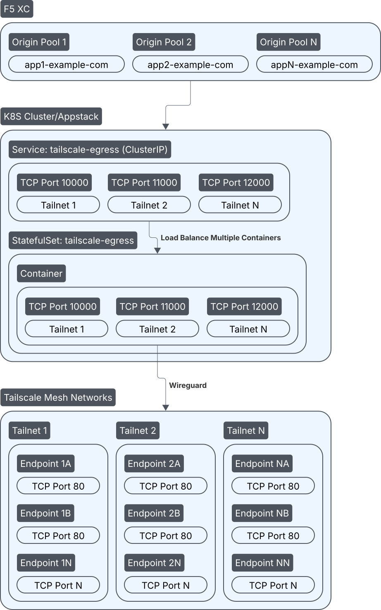

# F5 XC Tailnet Egress

A modular Terraform-based solution to generate Kubernetes manifests and F5 Distributed Cloud (F5 XC) Origin Pool configurations for connecting F5 XC workloads to multiple Tailscale networks using containerized proxies.

## 🌟 Features

- **Multi-Tailnet Support**: Connect to multiple Tailscale networks simultaneously with complete isolation
- **Pluggable Proxy Architectures**:
  - **[Proxtail](docs/proxtail.md) (Recommended)**: High-performance userspace `tsnet` Layer 4 reverse proxy in a single container. Native **TCP and UDP** support, automatic OAuth tag discovery, Prometheus metrics, and ephemeral node cleanup.
  - **[Envoy](docs/envoy.md)**: Enterprise L4 TCP proxy with HTTP CONNECT tunneling to local Tailscale sidecar containers.
- **StatefulSet Native**: Predictable pod identities (`tailscale-egress-0`) ensuring clean, deterministic node names in the Tailscale Admin Console
- **Kubernetes Native**: Complies with standard Kubernetes RBAC, Secrets, ConfigMaps, and Pod Security Standards
- **Dynamic Configuration**: Automatic port allocation, F5 XC Origin Pool mapping, and service discovery

## 🏗️ Architecture



### **🔍 Architecture Components Explained:**

#### **F5 XC Layer**

- **Origin Pools**: Define backend services pointing to the Kubernetes egress proxy
- **Health Checks**: Monitor service availability and routing health
- **Traffic Distribution**: Route requests based on routing policies
- **Security Policies**: WAF, DDoS protection, and security controls
- **Global Load Balancer**: Multi-region traffic distribution

#### **Kubernetes Layer**

- **Service**: Headless Service (`clusterIP: None`) exposing ports (`10000+`)
- **StatefulSet**: Main proxy deployment (`tailscale-egress`)
- **ConfigMap**: Proxy configuration template (`config.yaml` for Proxtail, `envoy.yaml` for Envoy)
- **Secrets**: Secure storage of Tailscale authentication keys
- **RBAC**: ServiceAccount, Role, and RoleBinding (when secrets are enabled)

#### **Tailscale Network Services**

- **Tailscale Nodes**: Nodes residing across multiple independent tailnets
- **Tailscale MagicDNS**: Services accessible via Tailscale hostnames or IP addresses
- **Port Mapping**: Internal service ports preserved through the proxy
- **Protocol Support**: TCP and UDP (via Proxtail), TCP tunneling (via Envoy)

---

## 🚀 Deployment Quick Start

> **Note**: The deployment script uses `kubectl` to apply configuration. Make sure it has been initialized with the appropriate KubeConfig credentials for your F5 XC site: [F5 XC Credentials Documentation](https://docs.cloud.f5.com/docs-v2/administration/how-tos/user-mgmt/Credentials).

### 1. Clone the repository

```bash
git clone <repository-url>
cd f5xc-tailnet-egress
```

### 2. Configure your tailnets

```bash
cp terraform.tfvars.example terraform.tfvars
# Edit terraform.tfvars with your tailnet configurations
```

#### Multi-Tailnet Configuration Example

```hcl
proxy_type    = "proxtail" # "proxtail" (recommended) or "envoy"
k8s_namespace = "default"

tailnets = [
  {
    tailnet_name   = "tailnet0"
    tailnet_key    = "tskey-auth-..."  # Reusable Tailscale auth key or OAuth client secret
    use_k8s_secret = true              # Enable Secret and RBAC management
    services = [
      {
        endpoint         = "app.tailnet0.ts.net"
        protocol         = "tcp"             # "tcp" or "udp" (Proxtail supports both)
        port             = 80
        connection_timeout = 10
        f5xc_origin_pool = "tailnet0-web-pool"
      }
    ]
  },
  {
    tailnet_name   = "tailnet1"
    tailnet_key    = "tskey-auth-..."
    use_k8s_secret = true
    services = [
      {
        endpoint         = "dns.tailnet1.ts.net"
        protocol         = "udp"             # UDP supported natively with proxtail
        port             = 53
        f5xc_origin_pool = "tailnet1-dns-pool"
      }
    ]
  }
]
```

### 3. Deploy the egress service

```bash
# Deploy with default proxy (proxtail)
./deploy.sh

# Or deploy explicitly by proxy type
./deploy.sh --proxy proxtail
./deploy.sh --proxy envoy
```

#### Phase 1: Infrastructure Provisioning (Terraform)
1. **Initialize Terraform** - Discovers providers and child modules (`modules/f5xc`, `modules/proxtail`, `modules/envoy`)
2. **Validate Configuration** - Verifies syntax and protocol compatibility
3. **Generate Files**:
   - Kubernetes manifests in `outputs/<proxy_type>/k8s/`
   - F5 XC origin pool JSONs in `outputs/<proxy_type>/f5xc/`
   - Configuration summary in `outputs/<proxy_type>/configuration-summary.md`

#### Phase 2: Application Deployment (Kubernetes + F5 XC)
1. **Start kubectl Proxy** - Connects to F5 XC API on `localhost:8001`
2. **Create Origin Pools** - Submits origin pool configurations to F5 XC
3. **Apply Kubernetes Manifests** - Applies ConfigMap, Service, Secrets, and StatefulSet
4. **Verify Deployment** - Displays live status and connection instructions

---

## 🔧 Port Allocations

The egress service uses a systematic, conflict-free port allocation scheme:

- **Service Ports**: `10000 + (tailnet_index * 1000) + service_index`

Example:
- Tailnet 0: ports 10000–10999
- Tailnet 1: ports 11000–11999
- Tailnet 2: ports 12000–12999

---

## 🔐 Security Features

- **Unprivileged Userspace Execution**: Proxtail runs under non-root UID `10001` without `CAP_NET_ADMIN` or `/dev/net/tun`.
- **RBAC Integration**: Automatic ServiceAccount, Role, and RoleBinding generation.
- **Secret Management**: Storage of Tailscale credentials in Kubernetes Secret objects.

---

## 📖 Proxy Implementations

- **[Proxtail Solution](docs/proxtail.md)**: Embedded `tsnet` proxy with native TCP & UDP support, single container per pod, and low resource overhead.
- **[Envoy Solution](docs/envoy.md)**: L4 TCP proxy with HTTP CONNECT tunneling over local Tailscale sidecar containers.

---

## 🛠️ Requirements

- Terraform >= 1.0
- Kubernetes cluster (or F5 XC vk8s / site cluster) with RBAC enabled
- Tailscale authentication keys (marked **Reusable** or OAuth client secrets)
- F5 Distributed Cloud access

## 🌐 Kubernetes Compatibility

These solutions can be deployed on standard Kubernetes distributions as well as F5 XC virtual sites.

## 🏢 F5 XC Deployment Options

On F5 Distributed Cloud (F5 XC), these solutions can be deployed on:
- **Regional Edges (RE)**: Centralized multi-region traffic routing
- **Customer Edges (CE)**: Local on-premises or cloud edge sites

---

## 📄 License

This project is licensed under the MIT License. See [LICENSE.md](LICENSE.md) for details.
