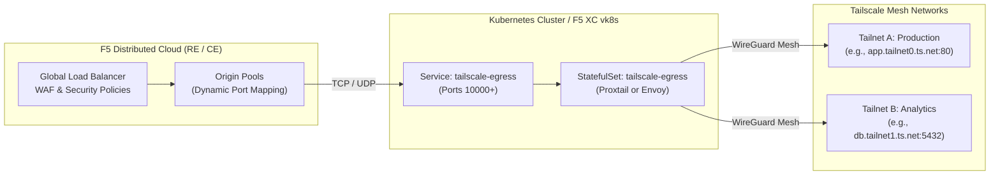

# F5 XC Tailnet Egress

<div align="center">

**Connect F5 Distributed Cloud workloads seamlessly to multiple Tailscale networks (Tailnets) using high-performance, Kubernetes-native proxy engines.**

[](LICENSE.md)
[](https://www.terraform.io/)
[](https://kubernetes.io/)
[](https://tailscale.com/)
[](https://cloud.f5.com/)

</div>

---

## 🌟 Overview

**F5 XC Tailnet Egress** bridges the enterprise security and global distribution of **F5 Distributed Cloud (F5 XC)** with the zero-trust mesh networking of **Tailscale**. 

Using Terraform, this solution automatically provisions F5 XC Origin Pools and renders production-ready Kubernetes manifests for proxying traffic into private Tailscale networks. It supports multiple isolated tailnets simultaneously with zero IP collision concerns.

### Why Combine F5 Distributed Cloud & Tailscale?

- 🌐 **Global Anycast Edge**: Deliver enterprise traffic through F5 XC's high-speed global network backbone across Regional Edges (RE) and Customer Edges (CE).
- 🛡️ **Comprehensive App Security**: Protect private Tailscale backends with F5 XC's industry-leading Web Application Firewall (WAF), API protection, Bot Defense, and DDoS mitigation.
- 🔒 **Zero-Trust Egress**: Keep backend services completely private inside your Tailnet without exposing public ingress ports or managing complex VPN gateways.
- ⚡ **Pluggable High-Speed Proxies**: Choose between the ultra-lightweight **[Proxtail](docs/proxtail.md)** proxy (native TCP & UDP) or the enterprise **[Envoy](docs/envoy.md)** L4 proxy.

---

## 🏗️ Architecture & Traffic Flow


---

## ⚡ Pluggable Proxy Engines

Choose the proxy architecture that best matches your application needs:

| Feature | [Proxtail Solution](docs/proxtail.md) *(Recommended)* | [Envoy Solution](docs/envoy.md) |
| :--- | :--- | :--- |
| **Engine** | Userspace [`tsnet`](https://pkg.go.dev/tailscale.com/tsnet) WireGuard engine | Envoy L4 TCP Proxy + Tailscale Sidecars |
| **Pod Footprint** | **Single container** (ultra-low CPU/memory) | $N+1$ containers (1 Envoy + $N$ Tailscale sidecars) |
| **Protocols** | **TCP & UDP** natively supported | **TCP only** (HTTP CONNECT tunneling) |
| **Security Context** | Unprivileged non-root (`UID 10001`), `restricted` profile | Unprivileged userspace containers |
| **Observability** | Native `/healthz`, `/readyz`, & `/metrics` (port 9000) | Standard Envoy admin & telemetry |
| **Lifecycle** | Ephemeral nodes with instant clean logout (`< 150ms`) | Containerboot ephemeral lifecycle |

---

## 🚀 Quick Start Guide

### Prerequisites

- [Terraform](https://www.terraform.io/) >= 1.0
- Access to an **F5 Distributed Cloud** environment with `kubectl` configured ([F5 XC Credentials Guide](https://docs.cloud.f5.com/docs-v2/administration/how-tos/user-mgmt/Credentials))
- Tailscale authentication keys (marked **Reusable** or OAuth Client Secrets)

---

### Step 1: Clone the Repository

```bash
git clone https://github.com/fadlytabrani/f5xc-tailnet-egress.git
cd f5xc-tailnet-egress
```

### Step 2: Configure Your Tailnets

Copy the example variables file:

```bash
cp terraform.tfvars.example terraform.tfvars
```

Edit `terraform.tfvars` with your tailnet services:

```hcl
proxy_type    = "proxtail" # "proxtail" (recommended) or "envoy"
k8s_namespace = "default"

tailnets = [
  {
    tailnet_name   = "tailnet0"
    tailnet_key    = "tskey-auth-..."  # Reusable Tailscale auth key or OAuth client secret
    use_k8s_secret = true              # Enable Kubernetes Secret & RBAC management
    services = [
      {
        endpoint         = "app.tailnet0.ts.net"
        protocol         = "tcp"
        port             = 80
        connection_timeout = 10
        f5xc_origin_pool = "tailnet0-web-pool"
      }
    ]
  },
  {
    tailnet_name   = "tailnet1"
    tailnet_key    = "tskey-auth-..."
    use_k8s_secret = true
    services = [
      {
        endpoint         = "dns.tailnet1.ts.net"
        protocol         = "udp"       # UDP supported natively with proxtail!
        port             = 53
        f5xc_origin_pool = "tailnet1-dns-pool"
      }
    ]
  }
]
```

### Step 3: Deploy

Run the automated deployment script:

```bash
# Deploy with default proxy (proxtail)
./deploy.sh

# Or select a proxy explicitly
./deploy.sh --proxy proxtail
./deploy.sh --proxy envoy
```

The script will:
1. Initialize Terraform and validate your configuration.
2. Cleanly generate Kubernetes manifests in `outputs/<proxy_type>/k8s/` and F5 XC Origin Pool JSONs in `outputs/<proxy_type>/f5xc/`.
3. Provide a configuration summary for review.
4. Establish an F5 XC API proxy session and automatically apply Origin Pools and Kubernetes manifests.

---

## 🔧 Port Allocation Scheme

The egress service uses a deterministic port allocation formula that avoids collisions across tailnets:

```math
\(\text{Exposed Port} = 10000 + (\text{tailnet\_index} \times 1000) + \text{service\_index}\)
```

| Tailnet Index | Service Index | Protocol | Exposed Port | Target Backend Example |
| :---: | :---: | :---: | :---: | :--- |
| `0` (Tailnet A) | `0` | TCP | `10000` | `app.tailnet0.ts.net:80` |
| `0` (Tailnet A) | `1` | TCP | `10001` | `api.tailnet0.ts.net:3000` |
| `1` (Tailnet B) | `0` | UDP | `11000` | `dns.tailnet1.ts.net:53` |
| `1` (Tailnet B) | `1` | TCP | `11001` | `db.tailnet1.ts.net:5432` |
| `2` (Tailnet C) | `0` | TCP | `12000` | `internal.tailnet2.ts.net:8443` |

---

## 📋 Configuration Reference

| Variable | Type | Default | Description |
| :--- | :--- | :--- | :--- |
| `proxy_type` | `string` | `"proxtail"` | Proxy engine to deploy: `"proxtail"` or `"envoy"`. |
| `k8s_namespace` | `string` | `"default"` | Target Kubernetes namespace for manifests and origin pools. |
| `container_registry` | `string` | `"docker.io"` | Container registry mirror for pulling proxy images. |
| `tailnets` | `list(object)` | *(required)* | List of tailnet configurations and backend services. |
| `tailnets[].tailnet_name` | `string` | *(required)* | Unique identifier for the tailnet. |
| `tailnets[].tailnet_key` | `string` | *(required)* | Reusable Tailscale auth key (`tskey-auth-...`) or OAuth secret (`tskey-client-...`). |
| `tailnets[].use_k8s_secret`| `bool` | `false` | When `true`, stores credentials in Kubernetes `Secret` objects. |
| `tailnets[].tailnet_advertise_tags` | `string` | `null` | Optional comma-separated ACL tags (e.g. `"tag:proxy,tag:prod"`). |
| `tailnets[].services[].endpoint` | `string` | *(required)* | Target backend hostname (MagicDNS) or Tailscale IP. |
| `tailnets[].services[].protocol` | `string` | `"tcp"` | Service protocol: `"tcp"` or `"udp"`. |
| `tailnets[].services[].port` | `number` | *(required)* | Destination port on the target tailnet backend. |
| `tailnets[].services[].f5xc_origin_pool` | `string` | *(required)* | F5 XC Origin Pool name. |
| `tailnets[].services[].connection_timeout` | `number` | `5` | Upstream connection timeout in seconds. |

---

## 🔍 Day-2 Operations & Verification

Once deployed, verify your proxy and test traffic flow with standard `kubectl` commands:

```bash
# Check StatefulSet and Pod health
kubectl get statefulset,svc -l app=tailscale-egress -n default

# Stream proxy logs
# For Proxtail:
kubectl logs -l app=tailscale-egress -c proxtail -n default -f

# For Envoy:
kubectl logs -l app=tailscale-egress -c envoy -n default -f

# Check Proxtail live health and readiness probes
kubectl exec -it statefulset/tailscale-egress -n default -- wget -qO- http://localhost:9000/readyz

# Query Prometheus metrics (Proxtail)
kubectl exec -it statefulset/tailscale-egress -n default -- wget -qO- http://localhost:9000/metrics

# Test local connectivity via port-forwarding
kubectl port-forward svc/tailscale-egress 10000:10000 -n default
curl http://localhost:10000
```

---

## 🏢 F5 Distributed Cloud Integration Highlights

- **Global High Availability**: Deploy origin pools across F5 XC **Regional Edges (RE)** for globally distributed multi-region traffic routing, or on **Customer Edges (CE)** for local edge/on-prem environments.
- **Deep Kubernetes Integration**: Origin pools integrate directly with Kubernetes DNS and service discovery via F5 XC vk8s.
- **Advanced Observability**: Leverage F5 XC's integrated telemetry, latency metrics, and traffic analytics alongside Prometheus proxy metrics.

---

## Acknowledgements

This project was built and optimized with the assistance of LLMs:
- **Gemini 4 Argon**
- **Gemini 3.8 Flash**

---

## 🤝 Contributing

Contributions are welcome! Feel free to open an issue or submit a pull request.

1. Fork the repository
2. Create a feature branch (`git checkout -b feature/new-proxy`)
3. Commit your changes (`git commit -m "Add new proxy"`)
4. Push to your branch (`git push origin feature/new-proxy`)
5. Open a Pull Request

---

## 📄 License

This project is licensed under the MIT License. See [LICENSE.md](LICENSE.md) for full details.
